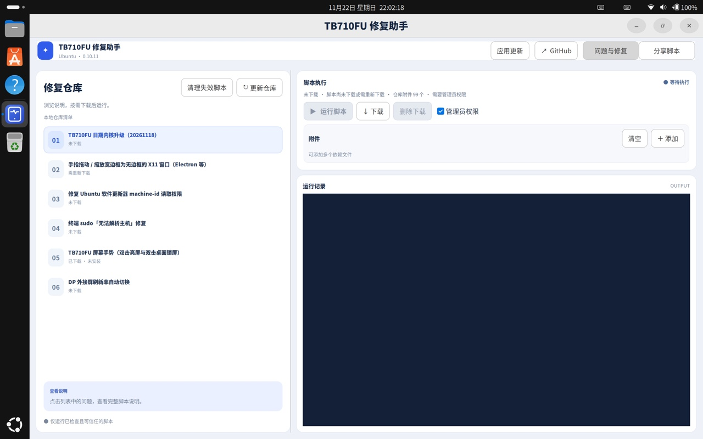
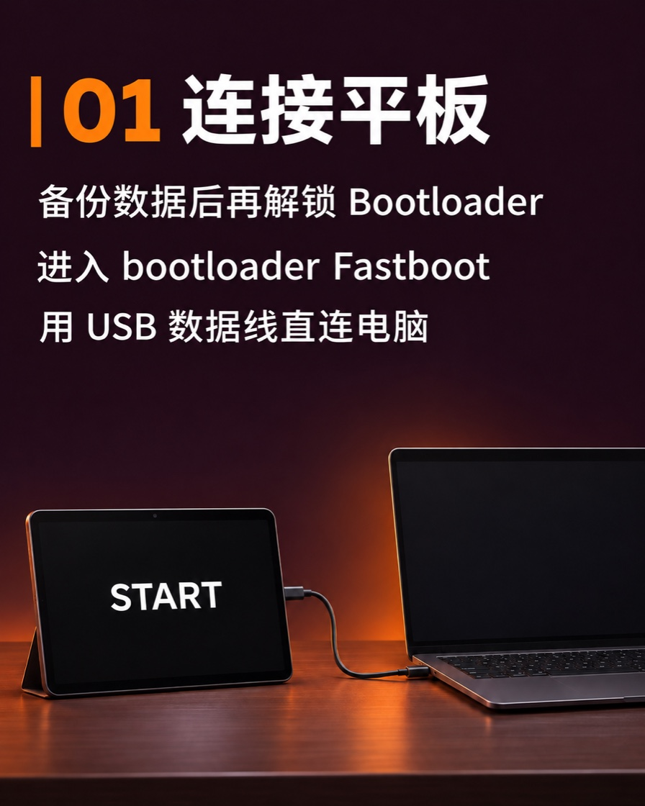

# Ubuntu 26.04 for Lenovo Xiaoxin Pad Pro GT (TB710FU)

[简体中文](README.md) · [Project introduction on Coolapk](https://www.coolapk.com/feed/75152374?s=YzhhY2E1NGQxMzFhNzVnNmIwMzAwOWJ6a1673) · [Installation tutorial on Coolapk](https://www.coolapk.com/feed/75219495?s=ZTUxYWRhNzgxMzFhNzVnNmIwMmZkZTd6a1673)

The **2026-11-22 BOOTFIX release** brings a native Ubuntu 26.04 GNOME desktop to the Lenovo Xiaoxin Pad Pro GT. Fastboot starts a temporary installation environment, which restores Ubuntu over USB HTTP. Use this release on **TB710FU**, which may identify itself in Fastboot as `topaz_prc_wifi`.

[**Download from GitHub (3 parts)**](https://github.com/fakerUZI/tb710fu-ubuntu-installer/releases/tag/2026-11-22-bootfix) · [Download the full installer from Quark Drive (about 5.70 GiB)](https://pan.quark.cn/s/03157595132e) · [SHA-256 checksum](SHA256SUMS.txt) · [Repair Assistant](https://github.com/fakerUZI/tb710fu-repair-catalog)

**QQ community group**  `1090866174`

> [!WARNING]
> This is a clean, single-system install. Back up personal data before unlocking the bootloader. Before flashing, also keep a copy of the original `boot_a` that matches your tablet's firmware. The installer erases the selected `userdata` or `arch` partition after you enter `ERASE`.

## Features

| Feature | Details |
| --- | --- |
| Desktop and display | The touchscreen works for browsing and light office work. The native 3200 × 2000 panel offers 60 Hz, 120 Hz, and 144 Hz in BOOTFIX, with automatic brightness and rotation. |
| Text input | Fcitx5 Chinese input and the on-screen keyboard include five candidate slots, a shortcut row with Esc, and a numeric layout. Install Chinese language support after your first login. |
| Audio and connectivity | Four speakers, dual microphones, Wi-Fi, and Bluetooth. Pair Bluetooth devices again after installation. |
| Cameras and face unlock | The rear camera offers full-resolution photos, tap-to-focus, macro camera access, and lighting. Matching front-camera components enable preview, local face unlock, and the option to keep the screen on while you look at it. |
| Tablet controls | A short press of the power button locks or wakes the screen. A long press opens the power menu. Closing the cover locks the screen and controls the backlight. |
| Android apps | DroidLoom opens APKs for installation and supports windowed or fullscreen apps and back gestures. *Reverse: 1999* was tested on the tablet. Check compatibility for each app and version. |
| Repair Assistant | Download individual fixes on an existing Ubuntu install. Newer entries include double-tap gestures, the flashlight and Quick Settings toggle, DisplayPort refresh profiles, and 60 / 144 Hz login display recovery. |

<details>
<summary>Screenshot from the tablet</summary>



</details>

## Before you start

- Verify the model is **TB710FU**. Unlock the bootloader, finish any pending Android OTA or snapshot merge, and check that **slot A** is active.
- The installer expects a **96 MiB** `boot_a` partition and exactly one candidate system partition, either `userdata` or `arch`, with at least **19 GiB** of capacity. If both exist or you have a different dual-boot layout, review the partition layout before proceeding.
- Use a reliable USB data cable and connect directly to the computer. Windows needs working Fastboot and USB network drivers. The Windows installer requires no Python. Linux and macOS require Python **3.11 or later** and `fastboot` on `PATH`. [Android SDK Platform-Tools](https://developer.android.com/tools/releases/platform-tools)

## Download from GitHub

Download all three parts from the [official release](https://github.com/fakerUZI/tb710fu-ubuntu-installer/releases/tag/2026-11-22-bootfix) [001](https://github.com/fakerUZI/tb710fu-ubuntu-installer/releases/download/2026-11-22-bootfix/TB710FU-Ubuntu-Fastboot-USB-20261122-BOOTFIX.zip.001) · [002](https://github.com/fakerUZI/tb710fu-ubuntu-installer/releases/download/2026-11-22-bootfix/TB710FU-Ubuntu-Fastboot-USB-20261122-BOOTFIX.zip.002) · [003](https://github.com/fakerUZI/tb710fu-ubuntu-installer/releases/download/2026-11-22-bootfix/TB710FU-Ubuntu-Fastboot-USB-20261122-BOOTFIX.zip.003) and save them in the same folder. Use a local filesystem that supports files larger than 4 GiB and free up about 5.70 GiB of additional space for the joined ZIP.

**Windows Command Prompt (CMD)**

```bat
set "ZIP=TB710FU-Ubuntu-Fastboot-USB-20261122-BOOTFIX.zip"
copy /b "%ZIP%.001"+"%ZIP%.002"+"%ZIP%.003" "%ZIP%"
certutil -hashfile "%ZIP%" SHA256
```

**Linux or macOS terminal**

```bash
ZIP=TB710FU-Ubuntu-Fastboot-USB-20261122-BOOTFIX.zip
cat "$ZIP.001" "$ZIP.002" "$ZIP.003" > "$ZIP"
```

On Linux, check the combined file with `sha256sum "$ZIP"`. On macOS, use `shasum -a 256 "$ZIP"`. Compare the result with the [full ZIP checksum](SHA256SUMS.txt) before extracting the archive. Use the [per-part checksums](https://github.com/fakerUZI/tb710fu-ubuntu-installer/releases/download/2026-11-22-bootfix/SHA256SUMS-parts.txt) to identify a damaged download.

## Install Ubuntu

1. Download `TB710FU-Ubuntu-Fastboot-USB-20261122-BOOTFIX.zip`, verify its SHA-256 checksum, and extract the full archive. On Windows, run `Get-FileHash -Algorithm SHA256 .\TB710FU-Ubuntu-Fastboot-USB-20261122-BOOTFIX.zip`. On Linux or macOS, use `sha256sum` or `shasum -a 256`, respectively. [Expected SHA-256 checksum](SHA256SUMS.txt)
2. Power off the tablet. Use **Power + Volume Up** to enter the bootloader Fastboot screen shown in the Coolapk guide. Confirm it shows **START**, then connect the USB data cable directly to the computer. If you see `fastbootd`, return to bootloader Fastboot.
3. Open the extracted `TB710FU-Ubuntu-Fastboot-USB-Clean` directory and launch the installer for your computer.

   | Host OS | Installer |
   | --- | --- |
   | Windows | Double-click `Install-TB710FU.cmd` |
   | Linux | Run `bash ./Install-Linux.sh` |
   | macOS | Double-click `Install-macOS.command` or run `bash ./Install-macOS.command` |

4. Choose your Ubuntu username and password. The username must start with a lowercase letter or an underscore and may use up to 31 lowercase letters, digits, underscores, and hyphens. The password must be 8–128 bytes.
5. Review the target partition and its capacity, then type **`ERASE`**. The installer saves a copy of the tablet's GPT to the computer before formatting. It renames `userdata` to `arch` when `userdata` is the target. Keep USB connected until the installer reports completion and Ubuntu shows the login screen.
6. Sign in with the account you just created. Open **Language Support** and install any missing Simplified Chinese language support, so Settings and the on-screen keyboard are fully localized when using Chinese. Sign out and back in after applying the language if needed. You can also install these packages in a terminal:

   ```bash
   sudo apt update
   sudo apt install language-pack-zh-hans language-pack-gnome-zh-hans
   ```

   Pair Bluetooth devices and enroll face unlock again under your new account. On an existing Ubuntu install, open the Repair Assistant and select **Update Repository** for later fixes. [Repair Assistant](https://github.com/fakerUZI/tb710fu-repair-catalog)

<details>
<summary>Connection diagram</summary>



</details>

## Troubleshooting

- **The computer cannot see the tablet.** Confirm the tablet shows **START**. On Windows, check the Fastboot driver. On Linux or macOS, check that `fastboot devices` lists only the target tablet. Try a different data cable or a direct USB port.
- **The temporary installer boots but the USB transfer does not start.** Look for a new NCM/RNDIS USB network adapter. If it has no address, set only that adapter to **`172.16.42.2/24`**, with no gateway, and allow **TCP 10809** from the tablet at **`172.16.42.1`**.
- **An older installer stalls at a black screen after transferring about 12 MB.** Exit the old installer, return to **START**, and download the full BOOTFIX ZIP linked above.
- **The slot, OTA, or partition check fails.** Verify the tablet's current state against the prerequisites. If a run is interrupted after writing the temporary boot image, keep the installer log and the backups made on the computer. Use the original `boot_a` that matches this tablet and its current firmware for recovery.
- **The screen stays dark after a 60 Hz unlock or login.** Update the Repair Assistant and run the **GNOME login and unlock black-screen recovery (60 / 144 Hz internal panel)** entry. [Online repair catalog](https://github.com/fakerUZI/tb710fu-repair-catalog)

This guide follows the two Coolapk posts by 青山揽梦丶 and adds the verified installer entry points for Windows, Linux, and macOS.
