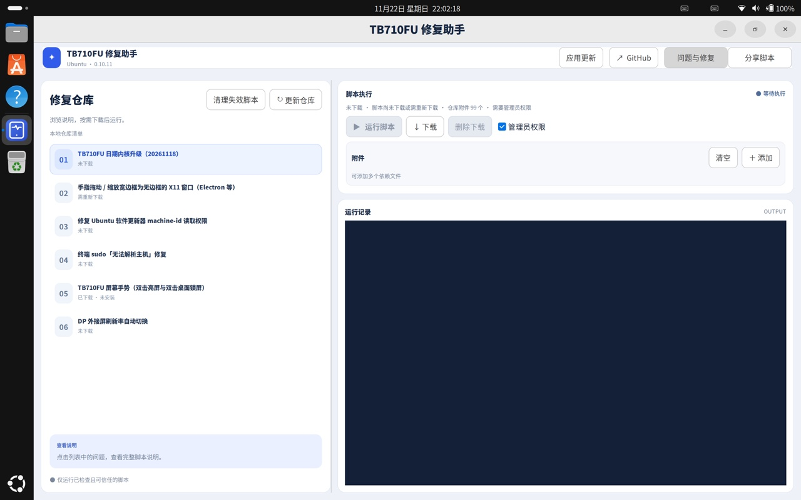
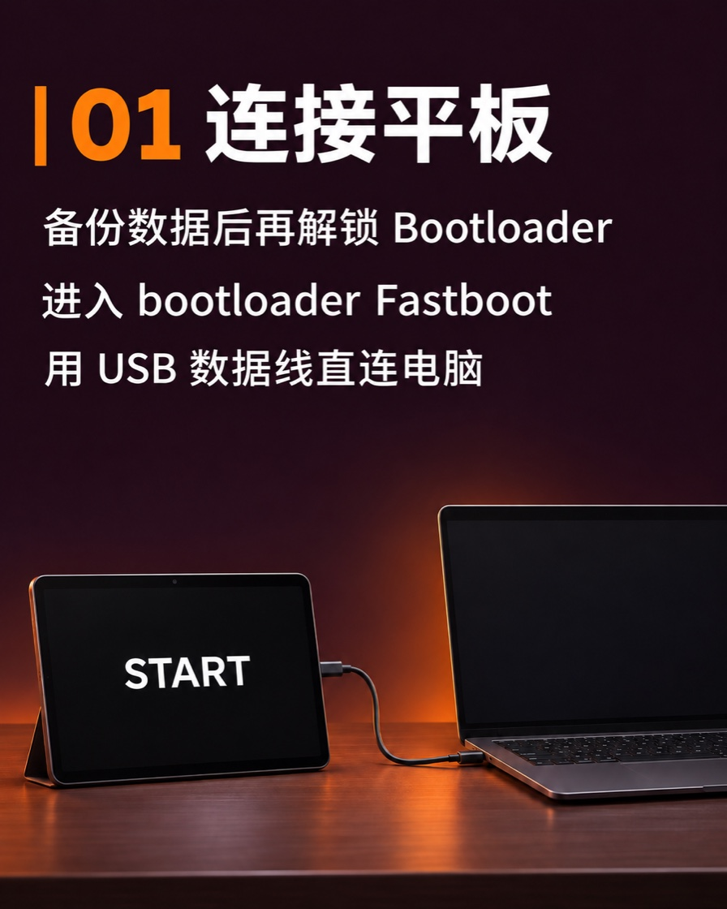

# 小新 Pad Pro GT（TB710FU）Ubuntu 26.04

[English](README.en.md) · [完美的 Ubuntu 它来了](https://www.coolapk.com/feed/75152374?s=YzhhY2E1NGQxMzFhNzVnNmIwMzAwOWJ6a1673) · [酷安安装教程](https://www.coolapk.com/feed/75219495?s=ZTUxYWRhNzgxMzFhNzVnNmIwMmZkZTd6a1673)

**2026-11-22 BOOTFIX 正式版**为联想小新 Pad Pro GT 提供原生 Ubuntu 26.04 GNOME 桌面。通过 Fastboot 启动临时安装环境，再经 USB HTTP 恢复系统。适用机型为 **TB710FU**，Fastboot 可能显示为 `topaz_prc_wifi`。

[**夸克网盘下载完整安装包（约 5.70 GiB）**](https://pan.quark.cn/s/03157595132e) · [SHA-256 校验文件](SHA256SUMS.txt) · [修复助手](https://github.com/fakerUZI/tb710fu-repair-catalog)

**QQ 交流群**  `1090866174`

> [!WARNING]
> 这是单系统清空安装。解锁 Bootloader 前先备份个人数据，并在刷入前保留与本机固件匹配的原始 `boot_a` 备份。输入 `ERASE` 后，安装器会清空所选的 `userdata` 或 `arch` 分区。

## 系统体验

| 功能 | 说明 |
| --- | --- |
| 桌面和显示 | 触屏可用于网页和轻办公。内屏原生 3200 × 2000，BOOTFIX 提供 60 Hz、120 Hz 和 144 Hz，并支持自动亮度和自动旋转。 |
| 中文输入 | 内置 Fcitx5 和屏幕键盘，支持五槽候选栏、带 Esc 的快捷栏及数字键盘。首次登录后请补装中文语言支持。 |
| 音频和连接 | 支持四扬声器、双麦克风录音、Wi‑Fi 和蓝牙。刷机后请重新配对蓝牙设备。 |
| 相机和人脸解锁 | 后摄支持全分辨率拍照、触摸对焦、微距入口和补光灯。保留匹配组件下的前摄预览，以及本地人脸解锁和注视亮屏。 |
| 平板交互 | 电源键短按锁屏或亮屏，长按打开电源菜单。支持皮套合盖锁屏和锁屏背光控制。 |
| 安卓应用 | DroidLoom 支持打开 APK 安装、窗口或全屏运行及返回手势。前作中实机测试过《重返未来：1999》，其他应用请按各自版本验证。 |
| 修复助手 | 已安装 Ubuntu 的用户可按需更新单项补丁。后续的双击手势、补光灯和快捷手电筒、DP 外屏刷新率切换以及 60 / 144 Hz 登录显示恢复均可在助手中获取。 |

<details>
<summary>Ubuntu 实机截图</summary>



</details>

## 安装前

- 确认平板是 **TB710FU**，Bootloader 已解锁、当前为 **A 槽**，Android OTA 已完成且无快照合并。
- 安装器要求 `boot_a` 为 **96 MiB**，并且只有一个候选目标分区，即 `userdata` 或 `arch` 两者之一，至少 **19 GiB**。如果两者同时存在，或是其他双系统布局，请先核对分区方案。
- 准备一根可靠的 USB 数据线，直连电脑。Windows 需要可用的 Fastboot 驱动和 USB 网卡驱动，包内安装器无需 Python。Linux 和 macOS 需要 Python **3.11 或更新版本**，并将 `fastboot` 加入 `PATH`。[Android SDK Platform-Tools](https://developer.android.com/tools/releases/platform-tools)

## 安装步骤

1. 下载 `TB710FU-Ubuntu-Fastboot-USB-20261122-BOOTFIX.zip`，核对 SHA-256 后完整解压。Windows 可用 `Get-FileHash -Algorithm SHA256 .\TB710FU-Ubuntu-Fastboot-USB-20261122-BOOTFIX.zip`，Linux 和 macOS 可分别用 `sha256sum` 或 `shasum -a 256` 检查。[SHA-256 校验文件](SHA256SUMS.txt)
2. 将平板关机，按 **电源键 + 音量加键** 进入酷安教程所示的 bootloader Fastboot。确认平板显示 **START**，再用 USB 数据线直连电脑。若显示 `fastbootd`，先返回 bootloader Fastboot。
3. 进入解压后的 `TB710FU-Ubuntu-Fastboot-USB-Clean` 目录，运行对应入口。

   | 电脑系统 | 安装入口 |
   | --- | --- |
   | Windows | 双击 `Install-TB710FU.cmd` |
   | Linux | 运行 `bash ./Install-Linux.sh` |
   | macOS | 双击 `Install-macOS.command`，或运行 `bash ./Install-macOS.command` |

4. 按提示输入自选的 Ubuntu 用户名和新密码。用户名以小写字母或下划线开头，最多 31 个字符，可使用小写字母、数字、下划线和连字符。新密码须为 8–128 字节。
5. 核对目标分区及容量后输入 **`ERASE`**。安装器会在格式化前将目标机的 GPT 备份保存到电脑。如果目标是 `userdata`，它会改名为 `arch`。保持 USB 连接，等安装器报告完成并看到 Ubuntu 登录界面，再按提示结束安装器。
6. 用刚设置的账户登录。首次进入后打开 **「语言支持」**，按提示补装简体中文语言包，让设置页面和屏幕键盘完整显示。应用语言后可注销再登录。如果要从终端补装，可运行：

   ```bash
   sudo apt update
   sudo apt install language-pack-zh-hans language-pack-gnome-zh-hans
   ```

   蓝牙设备需重新配对，人脸解锁需在新账户下重新录入。已有 Ubuntu 的用户可在修复助手点「更新仓库」，按需应用后续条目。[修复助手](https://github.com/fakerUZI/tb710fu-repair-catalog)

<details>
<summary>查看连接平板示意图</summary>



</details>

## 常见问题

- **电脑找不到设备**。确认屏幕停在 **START**。Windows 检查 Fastboot 驱动，Linux 或 macOS 检查 `fastboot devices` 是否只列出这台平板。可更换数据线或直连 USB 口。
- **临时系统启动了，但 USB 传输一直不开始**。确认系统出现新的 NCM/RNDIS USB 网卡。若未自动分配地址，只给这块 USB 网卡设为 **`172.16.42.2/24`**，网关留空，并允许来自平板 **`172.16.42.1`** 的 **TCP 10809** 连接。
- **旧包在传输约 12 MB 后黑屏**。退出旧安装器，回到 **START**，使用本页提供的 BOOTFIX 完整包。
- **提示槽位、OTA 或分区检查失败**。按安装器提示核对目标机条件。若已经写入临时引导后中断，保留电脑上的备份与错误信息，恢复时用与目标机当前固件对应的原始 `boot_a`。
- **60 Hz 解锁或登录后偶发无画面**。更新修复助手，运行 **「TB710FU GNOME 登录与解锁黑屏恢复（60 / 144 Hz 内屏）」**。[在线修复条目](https://github.com/fakerUZI/tb710fu-repair-catalog)

发布介绍和安装步骤整理自青山揽梦丶的两篇酷安文章，并按正式包入口补齐了 Windows、Linux 和 macOS 的流程。
